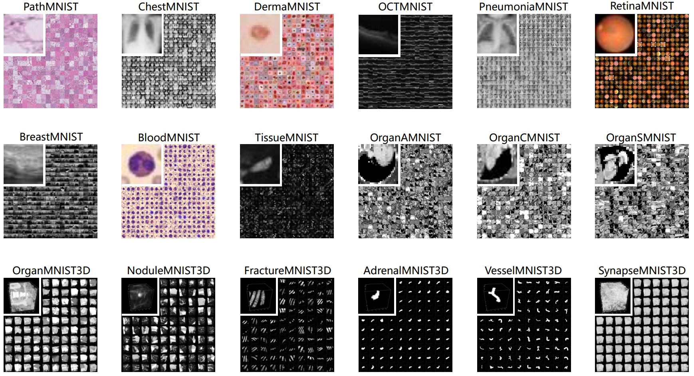
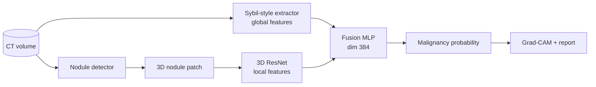

<div align="center">



# 🫁 Lung Cancer Hybrid Model

### Hybrid 3D CT nodule classifier — Sybil-style features fused with a 3D ResNet, served on Gradio

   

[](LICENSE)    

[](https://codespaces.new/shiroonigami23-ui/lung-cancer-hybrid?quickstart=1) [](https://github.com/shiroonigami23-ui/lung-cancer-hybrid/archive/refs/heads/main.zip)

[**🚀 Live Demo**](https://huggingface.co/spaces/ShiroOnigami23/lung-cancer-hybrid-app) · [**Overview**](#-overview) · [**Features**](#-features) · [**Architecture**](#-architecture) · [**Getting Started**](#-getting-started) · [**Roadmap**](#-roadmap)

</div>

---

## 📖 Overview

This project classifies **lung nodules in 3D CT** as benign or malignant with a **hybrid architecture**: a whole-volume
feature extractor (Sybil-style) and a **3D ResNet** over the nodule patch, combined by a **fusion MLP**. It includes the full
pipeline — DICOM/LIDC parsing, augmentation, training with custom losses and schedulers, LIDC/NLST evaluation, Grad-CAM
explanations, report generation — and a **Gradio** app deployed on Hugging Face Spaces.

**Benchmark (MedMNIST NoduleMNIST3D, derived from LIDC-IDRI):** accuracy **84.19 %**, AUC **0.9202**, F1 **0.6918**.

### ✨ Highlights

- **Hybrid fusion** — global volume context + local nodule detail
- **AUC 0.92** on NoduleMNIST3D
- **Explainable** — Grad-CAM heat-maps and auto-generated reports
- **Live demo** — [Space](https://huggingface.co/spaces/ShiroOnigami23/lung-cancer-hybrid-app) · [model](https://huggingface.co/ShiroOnigami23/lung-cancer-hybrid-model)

## 🧩 Features

| Feature | What it does |
|---|---|
| **Data loaders** | `data/` — DICOM loader, LIDC XML parser, 3D augmentations |
| **Models** | `models/` — `HybridLungNet`, `resnet3d`, `sybil_extractor`, `fusion_mlp` |
| **Training** | `training/` — trainer, losses, metrics, LR scheduler; `train.py` entry |
| **Quick benchmark** | `scripts/train_nodulemnist3d.py` on MedMNIST |
| **Evaluation** | `evaluation/` — LIDC & NLST eval, Grad-CAM, report generator |
| **Inference** | `inference/` — nodule detector + predictor |
| **App** | `app.py` / `app/gradio_app.py` with Docker image |
| **Colab pipeline** | `scripts/colab_pipeline.py`, `notebooks/colab_bootstrap.py` |

## 🛠 Tech Stack

| Layer | Technology |
|---|---|
| Deep learning | PyTorch, torchvision video (R3D-18) |
| Medical imaging | DICOM, LIDC-IDRI, NLST, MedMNIST |
| Serving | Gradio, Hugging Face Spaces, Docker |

## 🏗 Architecture

Two branches see the scan at different scales; a small MLP fuses their embeddings into a malignancy score.



➡️ Full design notes, data flow and design decisions: **[docs/ARCHITECTURE.md](docs/ARCHITECTURE.md)**

## 📁 Project Structure

```text
lung-cancer-hybrid/
├── data/         # dicom_loader, lidc_parser, augmentations
├── models/       # hybrid_lung_net, resnet3d, sybil_extractor, fusion_mlp
├── training/     # trainer, losses, metrics, scheduler
├── evaluation/   # eval_lidc, eval_nlst, grad_cam, report_gen
├── inference/    # nodule_detector, predict
├── app/          # gradio_app.py
├── scripts/      # train_nodulemnist3d, colab_pipeline, push_to_hf
├── train.py · app.py · Dockerfile
```

## 🚀 Getting Started

### Prerequisites

- Python 3.10+, CUDA GPU recommended for training

### 1. Get the code

Pick whichever method suits you:

| Method | Command |
|---|---|
| **HTTPS** | `git clone https://github.com/shiroonigami23-ui/lung-cancer-hybrid.git` |
| **SSH** | `git clone git@github.com:shiroonigami23-ui/lung-cancer-hybrid.git` |
| **GitHub CLI** | `gh repo clone shiroonigami23-ui/lung-cancer-hybrid` |
| **ZIP** | [Download](https://github.com/shiroonigami23-ui/lung-cancer-hybrid/archive/refs/heads/main.zip) and extract |
| **Codespaces** | [Open in browser](https://codespaces.new/shiroonigami23-ui/lung-cancer-hybrid?quickstart=1) — zero local setup, dev container preconfigured |

> 🔑 **Using SSH for the first time?** Generate a key with `ssh-keygen -t ed25519 -C "you@example.com"`, add the `.pub` contents at **GitHub → Settings → SSH and GPG keys**, then test with `ssh -T git@github.com`.

### 2. Install & set up

```bash
cd lung-cancer-hybrid
pip install -r requirements.txt          # training
pip install -r requirements-app.txt      # app only
```

### 3. Run

```bash
python scripts/train_nodulemnist3d.py    # quick MedMNIST benchmark
python train.py                          # full pipeline
python app.py                            # http://localhost:7860
```

### 🐳 Docker (optional)

```bash
docker build -t lung-cancer-hybrid . && docker run -p 7860:7860 lung-cancer-hybrid
```

## 🎮 Usage

> ⚠️ Research prototype — not a medical device and not for clinical decisions.

## 🗺 Roadmap

**v1 — Hybrid baseline (done)**

- [x] Hybrid architecture with fusion MLP
- [x] NoduleMNIST3D benchmark (AUC 0.92)
- [x] Grad-CAM, report generation, Gradio Space, Docker

**v1.1 — Stronger evaluation**

- [ ] Full LIDC-IDRI patient-level cross-validation
- [ ] NLST longitudinal evaluation (multi-year risk)
- [ ] Calibration and decision-curve analysis

**v1.2 — Model**

- [ ] Improve F1 with focal loss / class-balanced sampling
- [ ] Self-supervised pre-training on unlabeled CT
- [ ] Uncertainty estimates (MC dropout / ensembles)

**v2.0**

- [ ] End-to-end detection + classification on raw DICOM in the app
- [ ] Radiologist-in-the-loop review UI

➡️ Detailed plan, milestones and long-term vision: **[docs/ROADMAP.md](docs/ROADMAP.md)**

## 🤝 Contributing

Contributions, issues and feature requests are welcome!

1. Fork the repository
2. Create a feature branch: `git checkout -b feature/amazing-feature`
3. Commit your changes: `git commit -m "feat: add amazing feature"`
4. Push the branch: `git push origin feature/amazing-feature`
5. Open a Pull Request against `main`

Check the [issues page](https://github.com/shiroonigami23-ui/lung-cancer-hybrid/issues) and the [roadmap](docs/ROADMAP.md) for ideas on where to help.

## 📜 Changelog

See [CHANGELOG.md](CHANGELOG.md) for the release history.

## 📄 License

Distributed under the **MIT** license. See [LICENSE](LICENSE) for details.

## 👤 Author

**Aryan Singh Chandel** (Shiro)

[](https://github.com/shiroonigami23-ui)

<div align="center">

⭐ **If you find this project useful, consider giving it a star!** ⭐

</div>
