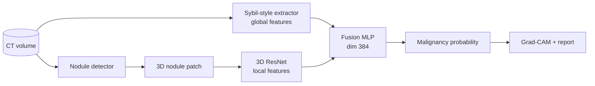

# 🏗 Architecture — Lung Cancer Hybrid Model

> Part of [lung-cancer-hybrid](https://github.com/shiroonigami23-ui/lung-cancer-hybrid). Back to the [README](../README.md).

## 1. System Overview

`HybridLungNet` takes a full CT volume and a cropped nodule patch. The Sybil-style extractor summarises the whole lung,
the 3D ResNet focuses on the nodule, and the fusion MLP combines both embeddings. Training utilities, evaluation on
LIDC/NLST and explainability live in their own packages; the Gradio app wraps the inference package.

## 2. Components

| Component | Location | Responsibility |
|---|---|---|
| **Hybrid model** | `models/hybrid_lung_net.py` | Combines volume and patch branches |
| **3D ResNet** | `models/resnet3d.py` | Local nodule encoder |
| **Volume encoder** | `models/sybil_extractor.py` | Global CT features |
| **Fusion** | `models/fusion_mlp.py` | Joint classifier head |
| **Trainer** | `training/trainer.py` | Loop, losses, metrics, scheduler |
| **Explainability** | `evaluation/grad_cam.py, report_gen.py` | Heat-maps and reports |

## 3. Data / Control Flow

1. DICOM series are loaded and resampled; nodules come from LIDC annotations or the detector.
2. Volume and patch tensors pass through their branches; embeddings are fused.
3. The loss is optimised; metrics (acc, AUC, F1) are logged.
4. At inference, Grad-CAM highlights evidence and a report is produced.

## 4. Key Design Decisions

| Decision | Rationale |
|---|---|
| Two-scale model | Malignancy depends on both nodule shape and surrounding lung |
| MedMNIST first | Fast, reproducible benchmark before full-size CT |

## 5. Known Limitations

- Benchmark numbers are on 28³/64³ MedMNIST volumes, not full-resolution CT

---
*Last updated: 2026-11-13*
